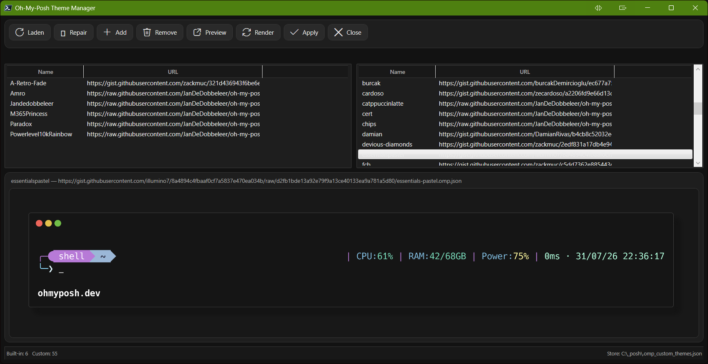
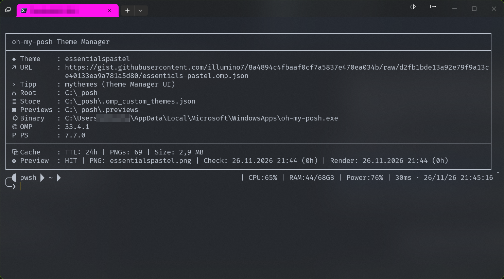

# 🖥️ PowerShell-Profil & Oh-My-Posh Theme Manager (DE/EN)
> Persönliches PowerShell-7-Profil mit **oh-my-posh** und einem grafischen **Theme-Manager (WPF)**: Themes durchsuchen, als Bild-Vorschau ansehen, testen und mit einem Klick anwenden. Dazu eine **Startkarte** in der Konsole, ein **Vorschau-Cache** und automatische **GitHub/Gist → RAW**-Korrektur. Zweisprachige Doku – EN folgt unten.

<p align="left">
  
  
  
  
  
</p>

## 📸 Screenshots
**Theme-Manager (`mythemes`)** – Built-in- und Custom-Themes, gerenderte Vorschau des ausgewählten Themes:



**Startkarte beim Öffnen der Konsole** – aktives Theme, Pfade, Versionen und Cache-Status:



## ✨ Features
- **WPF-Theme-Manager** (`mythemes`) mit Toolbar: *Laden, Repair, Add, Remove, Preview, Render, Apply, Close*.
- **Zwei Listen**: eingebaute Themes und eigene Themes (JSON-Store), Mehrfachauswahl zum Entfernen.
- **Bild-Vorschau** im Fenster: oh-my-posh rendert das Theme als PNG (`oh-my-posh config export image`).
- **Vorschau-Cache** mit Metadaten (TTL, SHA-256-Hash, Änderungszeit) – neu gerendert wird nur bei Änderungen.
- **Live-Preview** in einer separaten `pwsh`-Session ohne Profil – deine aktuelle Shell bleibt unverändert.
- **Apply** in der aktuellen Session inkl. Löschen der oh-my-posh-Init-Caches (auch MSIX/Store-Installation).
- **Automatische URL-Korrektur**: GitHub `blob`/`tree`/`raw`-Links und Gist-Seiten werden zu RAW-URLs.
- **Toleranter JSON-Import**: Kommentare und überzählige Kommas in Theme-Dateien werden bereinigt.
- **Auto-Repair** des Theme-Stores und **Auto-Apply** des zuletzt verwendeten Themes beim Start.
- **Startkarte** in der Konsole (Theme, URL, Pfade, oh-my-posh-/PowerShell-Version, Cache- und Vorschau-Status).
- **Windows-11-Optik**: Hell/Dunkel und Akzentfarbe von Windows, Acrylic-Hintergrund, Segoe-Fluent-Icons.

## 🧩 Voraussetzungen
- **Windows 10/11** (für den WPF-Theme-Manager; Acrylic/Mica ab Windows 11)
- **PowerShell 7** (getestet mit 7.7)
- **oh-my-posh** (getestet mit 33.x), z. B. `winget install JanDeDobbeleer.OhMyPosh`
- **Nerd Font** im Windows Terminal (z. B. *FiraCode Nerd Font Mono*)

> Stelle im Windows Terminal → PowerShell → Darstellung → Schriftart deinen Nerd Font ein, sonst fehlen Symbole.

## ⚙️ Installation / Update
```powershell
git clone https://github.com/zackmuc/powershell-profile.git
cd powershell-profile

Copy-Item $PROFILE "$PROFILE.bak" -ErrorAction SilentlyContinue
Copy-Item .\Microsoft.PowerShell_profile.ps1 $PROFILE -Force
. $PROFILE
```

## 🧑‍💻 Nutzung
```powershell
mythemes          # Theme-Manager öffnen (Alias für Show-ThemeManager)
```
| Button | Funktion |
|---|---|
| **Laden** | Listen neu einlesen |
| **Repair** | Store-URLs in RAW-URLs umwandeln |
| **Add** | Theme per URL (GitHub, Gist, RAW oder lokaler Pfad) hinzufügen |
| **Remove** | Ausgewählte Custom-Themes entfernen (mit Rückfrage) |
| **Preview** | Theme in neuem Fenster ausprobieren |
| **Render** | Vorschau-Bild neu erzeugen (Cache ignorieren) |
| **Apply** | Theme in der aktuellen Session aktivieren und als Standard merken |

### Eigene Themes per Befehl
```powershell
Add-CustomTheme -Name 'mein-theme' -Url 'https://github.com/user/repo/blob/main/mein.omp.json'
Add-CustomTheme -Name 'mein-theme' -Url '...' -AutoRename   # bei Namenskonflikt "-1", "-2" anhängen
Remove-CustomTheme -Name 'mein-theme'
```

### Dateien & Speicherorte
| Datei | Zweck |
|---|---|
| `C:\_posh\.omp_custom_themes.json` | Eigene Themes (`Name`, `Url`) |
| `C:\_posh\.previews\*.png` (+ `.meta.json`) | Vorschau-Cache |
| `%USERPROFILE%\.posh_last_theme.txt` | Zuletzt angewendetes Theme |

Ist `C:\_posh` nicht vorhanden, wird `%USERPROFILE%\_posh` bzw. `%LOCALAPPDATA%\oh-my-posh` verwendet.

Ausführliche Doku (Konfiguration, Funktionsreferenz, Troubleshooting): **[docs/DOKUMENTATION.md](docs/DOKUMENTATION.md)**

## 🏷️ Versionierung & Releases
```powershell
git tag v2.0
git push origin v2.0
gh release create v2.0 --title "Version 2.0" --notes "WPF-Theme-Manager, Vorschau-Cache, Startkarte."
```

---

# 🖥️ PowerShell Profile & Oh-My-Posh Theme Manager (EN)
> Personal PowerShell 7 profile with **oh-my-posh** and a graphical **theme manager (WPF)**: browse themes, see rendered image previews, try them out and apply them with one click. Plus a console **startup card**, a **preview cache** and automatic **GitHub/Gist → RAW** URL correction.

## 📸 Screenshots


## ✨ Features
- **WPF theme manager** (`mythemes`) with toolbar: *Reload, Repair, Add, Remove, Preview, Render, Apply, Close*.
- **Two lists**: built-in themes and custom themes (JSON store), multi-select for removal.
- **Image preview** in the window, rendered by `oh-my-posh config export image`.
- **Preview cache** with metadata (TTL, SHA-256 hash, mtime) – re-renders only when the theme changed.
- **Live preview** in a separate `pwsh` session without profile – your current shell stays untouched.
- **Apply** in the current session, including clearing oh-my-posh init caches (also for MSIX/Store installs).
- **Automatic URL correction**: GitHub `blob`/`tree`/`raw` links and Gist pages are converted to RAW URLs.
- **Lenient JSON import**: comments and trailing commas in theme files are cleaned up.
- **Auto-repair** of the theme store and **auto-apply** of the last used theme on startup.
- **Startup card** in the console (theme, URL, paths, oh-my-posh/PowerShell version, cache and preview status).
- **Windows 11 look**: follows Windows light/dark mode and accent color, acrylic backdrop, Segoe Fluent icons.

## 🧩 Requirements
- Windows 10/11 (WPF; acrylic/mica requires Windows 11)
- PowerShell 7 (tested with 7.7)
- oh-my-posh (tested with 33.x), e.g. `winget install JanDeDobbeleer.OhMyPosh`
- A Nerd Font in Windows Terminal

## ⚙️ Installation / Update
```powershell
git clone https://github.com/zackmuc/powershell-profile.git
cd powershell-profile
Copy-Item $PROFILE "$PROFILE.bak" -ErrorAction SilentlyContinue
Copy-Item .\Microsoft.PowerShell_profile.ps1 $PROFILE -Force
. $PROFILE
```

## 🧑‍💻 Usage
```powershell
mythemes                                              # open the theme manager
Add-CustomTheme -Name 'my-theme' -Url '<GitHub/Gist/RAW URL or local path>'
Remove-CustomTheme -Name 'my-theme'
```
Custom themes are stored in `C:\_posh\.omp_custom_themes.json`, previews in `C:\_posh\.previews`, the last applied theme in `%USERPROFILE%\.posh_last_theme.txt`.

Full documentation (configuration, function reference, troubleshooting): **[docs/DOKUMENTATION.md](docs/DOKUMENTATION.md)**

---

© 2025–2026 Peter Auerbacher — MIT License
