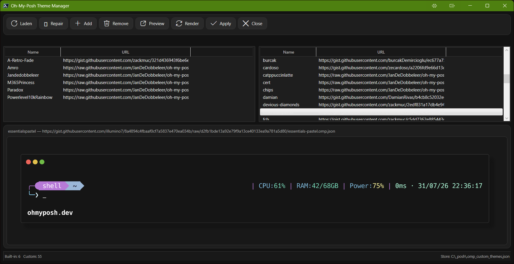
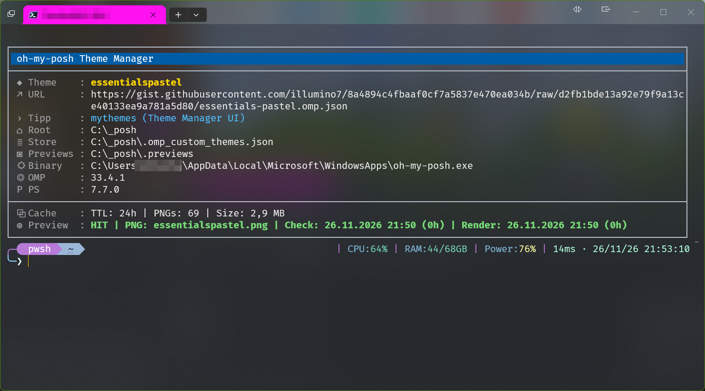

# 📘 Dokumentation – PowerShell-Profil & Oh-My-Posh Theme Manager

> Diese Seite beschreibt Aufbau, Konfiguration und Funktionen von `Microsoft.PowerShell_profile.ps1`.
> Kurzüberblick und Installation: siehe [README](../README.md). *English summary at the end.*

## Inhalt
1. [Was passiert beim Start?](#1-was-passiert-beim-start)
2. [Theme-Manager (`mythemes`)](#2-theme-manager-mythemes)
3. [Startkarte](#3-startkarte)
4. [Konfiguration](#4-konfiguration)
5. [Dateien & Speicherorte](#5-dateien--speicherorte)
6. [Vorschau-Cache](#6-vorschau-cache)
7. [URL-Behandlung](#7-url-behandlung)
8. [Funktionsreferenz](#8-funktionsreferenz)
9. [Troubleshooting](#9-troubleshooting)

---

## 1. Was passiert beim Start?
Beim Laden des Profils läuft in dieser Reihenfolge:

1. **Speicherort bestimmen** (`Get-RootDir`) und Ordner `.previews` anlegen.
2. **Auto-Repair**: Alle gefundenen Theme-Stores werden geprüft; Nicht-RAW-URLs werden in RAW-URLs umgeschrieben. Meldung nur, wenn etwas korrigiert wurde.
3. **Auto-Apply**: Das zuletzt angewendete Theme aus `~\.posh_last_theme.txt` wird mit `oh-my-posh init pwsh` geladen.
4. **Startkarte** wird ausgegeben (siehe [Abschnitt 3](#3-startkarte)). Ist die Vorschau des aktiven Themes veraltet oder fehlt, wird sie dabei neu gerendert.

## 2. Theme-Manager (`mythemes`)

`mythemes` (bzw. `Show-ThemeManager`) öffnet ein WPF-Fenster:

- **Links – Built-in**: fest im Profil hinterlegte Themes (`$BuiltInThemes`).
- **Rechts – Custom**: eigene Themes aus dem JSON-Store, Mehrfachauswahl möglich.
- **Unten – Vorschau**: gerendertes PNG des ausgewählten Themes, darüber Name und RAW-URL.
- **Statusleiste**: Anzahl Built-in/Custom-Themes, Pfad zum Store und kurze Statusmeldungen.

Beim Öffnen wird das zuletzt angewendete Theme automatisch ausgewählt und gerendert.

| Button | Aktion |
|---|---|
| **Laden** | Listen neu einlesen |
| **Repair** | `Repair-StoreUrls` für alle Store-Kandidaten ausführen |
| **Add** | Dialog für URL und Name → `Add-CustomTheme -AutoRename` (URL wird vorher heruntergeladen und als JSON geprüft) |
| **Remove** | Ausgewählte Custom-Themes nach Rückfrage entfernen |
| **Preview** | Theme in neuem `pwsh -NoProfile`-Fenster testen (`Preview-Theme`) |
| **Render** | Vorschau-PNG neu erzeugen, Cache ignorieren |
| **Apply** | Theme in der aktuellen Session aktivieren, als „zuletzt verwendet“ speichern, Fenster schließen |
| **Close** | Fenster schließen |

**Darstellung**: Hell-/Dunkelmodus und Akzentfarbe werden aus der Windows-Registry gelesen. Unter Windows 11 bekommt das Fenster einen Acrylic-Hintergrund und einen Rahmen in Akzentfarbe (`DwmSetWindowAttribute`). Icons kommen aus *Segoe Fluent Icons*.

## 3. Startkarte

| Zeile | Inhalt |
|---|---|
| Theme / URL | Name und Quelle des aktiven Themes |
| Tipp | Hinweis auf `mythemes` |
| Root / Store / Previews | verwendete Speicherorte |
| Binary / OMP / PS | Pfad und Version von oh-my-posh, PowerShell-Version |
| Cache | TTL, Anzahl und Größe der Vorschau-PNGs |
| Preview | Status der Vorschau des aktiven Themes: `HIT` (aktuell), `STALE` (älter als TTL), `MISS` (fehlt) |

Farben werden nur genutzt, wenn das Terminal VT-Sequenzen unterstützt (`$PSStyle`).

## 4. Konfiguration
Die Einstellungen stehen als Variablen am Anfang bzw. vor der Startkarte im Profil:

| Variable | Standard | Bedeutung |
|---|---|---|
| `$PreferredRoot` | `C:\_posh` | bevorzugter Speicherort |
| `$RootCandidates` | `C:\_posh`, `~\_posh`, `%LOCALAPPDATA%\oh-my-posh` | Fallback-Reihenfolge |
| `$script:PreviewMaxAgeHours` | `24` | TTL des Vorschau-Caches in Stunden |
| `$BuiltInThemes` | 6 Themes | Liste der eingebauten Themes (`Name`, `Url`) |
| `$script:StartupCardMaxWidth` | `120` | maximale Breite der Startkarte |
| `$script:StartupShowUrl` | `$true` | URL-Zeile in der Startkarte anzeigen |

## 5. Dateien & Speicherorte
| Datei | Zweck |
|---|---|
| `<Root>\.omp_custom_themes.json` | Custom-Themes als JSON-Array `[{ "Name": "...", "Url": "..." }]` |
| `<Root>\.previews\<Name>.png` | gerenderte Vorschau |
| `<Root>\.previews\<Name>.png.meta.json` | Cache-Metadaten (Hash, Zeitstempel, Quelle) |
| `%USERPROFILE%\.posh_last_theme.txt` | URL/Pfad des zuletzt angewendeten Themes |
| `%TEMP%\omp_*.json` | temporäre, bereinigte Theme-Kopie (wird nach dem Rendern gelöscht) |

## 6. Vorschau-Cache
`Export-ThemePreviewImage` rendert nur, wenn nötig:

1. PNG vorhanden und letzte Prüfung jünger als TTL → Cache verwenden.
2. **Lokale Datei**: unveränderte Änderungszeit oder gleicher SHA-256-Hash → Cache verwenden.
3. **Remote-URL**: Theme herunterladen; gleicher Hash → Cache verwenden.
4. Sonst: neu rendern mit `oh-my-posh config export image` und Metadaten speichern.

`-Force` (Button **Render**) überspringt alle Prüfungen.

## 7. URL-Behandlung
`Resolve-ThemeUrlToRaw` wandelt Links automatisch um:

| Eingabe | Ergebnis |
|---|---|
| `https://github.com/u/r/blob/main/x.omp.json` | `https://raw.githubusercontent.com/u/r/main/x.omp.json` |
| `https://github.com/u/r/tree/…` bzw. `/raw/…` | ebenso |
| `https://gist.github.com/u/<id>` | `https://gist.githubusercontent.com/u/<id>/raw` |
| lokaler Pfad | absoluter Pfad |

`Get-ThemeContent` probiert mehrere Varianten (RAW, `?plain=1`, `?raw=1`, Original), verwirft HTML-Antworten und prüft das Ergebnis als JSON. `Sanitize-Json` entfernt vorher `/* */`- und `//`-Kommentare sowie überzählige Kommas.

## 8. Funktionsreferenz
**Öffentlich (für den direkten Aufruf gedacht)**

| Funktion | Beschreibung |
|---|---|
| `mythemes` / `Show-ThemeManager` | Theme-Manager öffnen |
| `Add-CustomTheme -Name -Url [-AutoRename]` | Theme prüfen und zum Store hinzufügen |
| `Remove-CustomTheme -Name <string[]>` | Theme(s) aus dem Store entfernen |
| `Apply-Theme <Url>` | Theme in der aktuellen Session aktivieren |
| `Preview-Theme <Url>` | Theme in neuem Fenster testen |
| `Export-ThemePreviewImage -Url -Name [-Force]` | Vorschau-PNG erzeugen/aus Cache holen |
| `Repair-StoreUrls <Pfad>` | URLs eines Stores in RAW-URLs umschreiben |
| `Clear-OMPInitCaches` | `init.*.ps1`-Caches von oh-my-posh löschen |

**Intern (Hilfsfunktionen)**: `Get-RootDir`, `Sanitize-Json`, `Normalize-ThemeUrl`, `Resolve-ThemeUrlToRaw`, `Invoke-DownloadText`, `Get-ThemeContent`, `Load-CustomThemes`, `Save-CustomThemes`, `Get-OhMyPoshPath`, Vorschau-Metadaten (`Get-PreviewMetaPath`, `Load-PreviewMeta`, `Save-PreviewMeta`, `Get-StringSha256`), Windows-Design (`Get-WindowsAppTheme`, `Get-WindowsAccentColor`, `Set-BrushResource`, `Apply-ThemeToThemeManagerWindow`, `Enable-Win11Backdrop`) und Startkarte (`Show-OMPStartupCard`, `Show-BoxRow`, `Get-ThemePreviewStatus`, `Refresh-ThemePreviewIfStale`, `Get-PreviewCacheStats`, `Format-Bytes`, `Wrap-Text`).

## 9. Troubleshooting
- **„Download ergab HTML/Seite“** – die URL zeigt auf eine Webseite statt auf die JSON-Datei. RAW-Link verwenden oder **Repair** ausführen.
- **Keine Vorschau / „Export fehlgeschlagen“** – prüfen, ob `oh-my-posh` im `PATH` liegt (`Get-Command oh-my-posh`) und eine aktuelle Version installiert ist.
- **Theme ändert sich nach Apply nicht** – `Clear-OMPInitCaches` ausführen und eine neue Konsole öffnen.
- **Symbole fehlen oder sind Kästchen** – Nerd Font im Windows Terminal einstellen.
- **Kein Acrylic-Hintergrund** – erst ab Windows 11 verfügbar; unter Windows 10 erscheint ein normales Fenster.
- **Fehler „Unable to cast … to System.Windows.Media.Brush“** – bei eigenen Anpassungen Farben/Brushes aus `System.Windows.Media` verwenden, nicht aus `Windows.Media`.
- **Profil wird nicht geladen** – PowerShell 7 (`pwsh`) verwenden, nicht Windows PowerShell 5.1, und nicht mit `-NoProfile` starten. Pfad prüfen mit `$PROFILE`.

---

## English summary
The profile stores custom themes in `<Root>\.omp_custom_themes.json` (default root `C:\_posh`), renders previews into `<Root>\.previews` with a hash/TTL-based cache (`$script:PreviewMaxAgeHours`, default 24 h), auto-repairs store URLs to RAW and re-applies the last theme on startup, then prints a startup card. `mythemes` opens the WPF theme manager (Reload, Repair, Add, Remove, Preview, Render, Apply, Close). GitHub `blob`/`tree`/`raw` and Gist URLs are converted to RAW automatically, and theme JSON is sanitized (comments, trailing commas) before use. See the tables above for configuration variables, files and the function reference.
